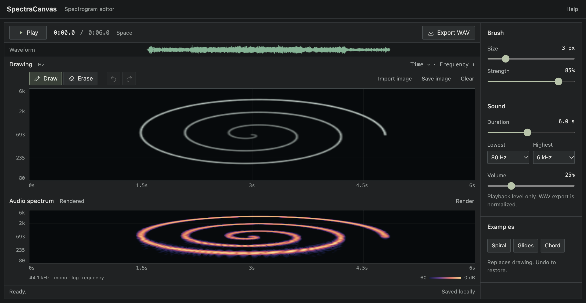

# SpectraCanvas

Paint a spectrogram, hear the drawing, export a WAV.

Runs entirely in the browser. No build step, no dependencies, no network.



**Try it:** https://gdamdam.github.io/spectracanvas/

## Run locally

```sh
npm start
```

Open http://127.0.0.1:4173. Needs Node 20 or later.

## Use

- Draw left to right. Across is time, up is pitch, brighter is louder.
- Press **Play** or Space to render and listen.
- Import any image, or pick an example.
- **Export WAV** saves a normalized 44.1 kHz 16-bit mono file.
- Your drawing is autosaved in the browser.

Shortcuts: `B` draw, `E` erase, `Cmd/Ctrl Z` undo, `Esc` stop.

## How it works

The canvas is a grid of 384 time steps by 128 frequency rows. Rows are spaced logarithmically between the chosen low and high frequencies.

Each row drives one sine oscillator. The pixel brightness along the row sets its volume over time. All 128 oscillators are summed, normalized, and given a short fade in and out.

The bottom panel is not a copy of your drawing. It is a real spectrogram of the generated audio, computed with an FFT. That is why fine details blur a little: it shows what you will actually hear.

Synthesis and analysis run in a web worker so the page stays responsive.

## Develop

```sh
npm test        # DSP and project-format tests
npm run check   # syntax and version check
```

| File | Role |
|------|------|
| `src/dsp.js` | synthesis, FFT, WAV encoding |
| `src/project.js` | save format and image import |
| `src/app.js` | editor, playback, UI |
| `src/render-worker.js` | runs the DSP off the main thread |
| `server.mjs` | tiny local static server |

Pushes to `main` deploy to GitHub Pages. To refresh the screenshot, run the app and `node scripts/screenshot.mjs`.

## License

GPL-3.0-or-later. See [LICENSE](LICENSE).
